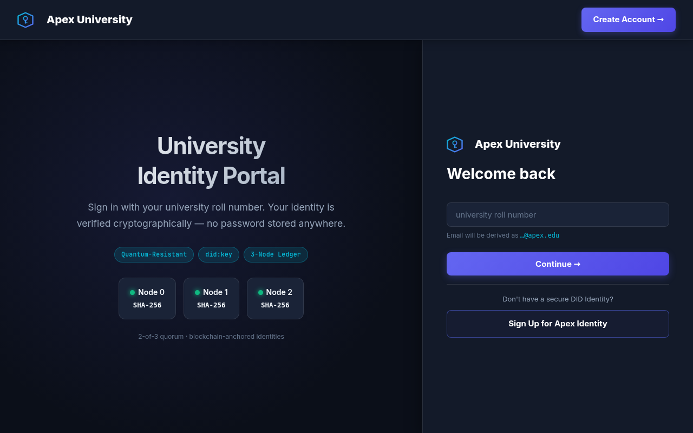
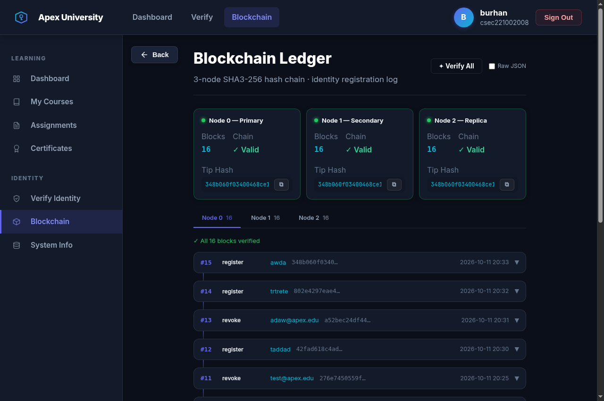

# Apex-PQ

**A post-quantum DID login portal prototype: ML-DSA-44 challenge-response authentication, a Chrome wallet extension, and a replicated hash-chained identity ledger.**

[](#cryptography)
[](#ledger)
[](#quickstart)
[](#wallet-extension)

> **Status: educational prototype. Not production software.** It demonstrates the flow of passwordless post-quantum authentication for a university portal. See [Security status](#security-status-and-known-limitations) before running it anywhere other than localhost.

## What it does

- Students and admins authenticate by **signing a server challenge** (32-byte nonce, 120 s TTL) with an ML-DSA-44 key. There are no passwords.
- Identities are W3C-style `did:key` identifiers derived from the ML-DSA-44 public key.
- Approvals and revocations are written to a **3-replica, hash-chained ledger** (SHA3-256) with a block explorer.
- A **Chrome/Brave/Edge Manifest V3 wallet extension** holds accounts and signs the login challenge.

## Screenshots

| Login | Admin dashboard | Ledger explorer |
|---|---|---|
|  |  |  |

More in [`docs/images`](docs/images): signup, wallet, registered identities with revocation, pending state, student dashboard.

## Quickstart

Requirements: Docker Engine 20.10+ and Docker Compose v2.

```bash
git clone https://github.com/0x4rc4n3/Apex-PQ.git
cd Apex-PQ
docker compose up --build
```

Open `http://localhost:8080`. On Windows, use Docker Desktop (WSL 2 backend) and run the same commands in PowerShell.

Native (Linux x86_64, Python 3.10+): `python3 -m venv venv && source venv/bin/activate && pip install -r requirements.txt && ./run.sh native`

### Wallet extension

1. Open `chrome://extensions` and enable **Developer mode**.
2. Click **Load unpacked** and select `pqc-identity/wallet-extension`.
3. Pin **Apex wallet**. The demo master PIN is `1342`.

### Demo accounts (testing only)

| Role | Identifier |
|---|---|
| Admin | `admin` |
| Students | `csec221002008`, `csec221102054`, `csec221102034` |

Their keys are pre-loaded in `wallet-extension/seeds.json` for evaluation. **They are public demo keys; never reuse them.**

## How login works

1. User enters a roll number or DID. The server issues a random challenge.
2. The wallet signs the challenge with the account's ML-DSA-44 secret key (via the server's `/api/sign` helper in this prototype).
3. The server verifies the signature with liboqs against the public key anchored on the ledger, then starts a session.
4. An admin can revoke an identity; a revocation block is appended to the ledger and the user can no longer log in.

## Cryptography

- **Signatures:** ML-DSA-44 (FIPS 204, security category 2) through the liboqs C library via `ctypes` (`pqc_engine.py`). Sizes: public key 1312 B, secret key 2560 B, signature up to 2420 B.
- **Hashing:** SHA3-256 for block hashes.
- **Identifiers:** `did:key`-style identifiers derived from the public key.

## Ledger

`ledger.py` maintains three SQLite databases (`node0`, `node1`, `node2`) as replicas of one hash chain. A block is appended to all replicas and the write succeeds if at least **2 of 3** confirm. Each replica's chain can be verified independently from the explorer.

This is a **replicated, tamper-evident log**, not Byzantine fault tolerant consensus: the replicas run in one process, one coordinator assigns block indexes, and there is no voting protocol between independent nodes.

## Security status and known limitations

Known gaps, tracked for the next iteration:

- **Server-side key handling.** Keypairs are generated by the server (`/api/keygen`) and the wallet calls `/api/sign` with the secret key. Secret keys therefore pass through the server. Target design: client-side keygen and signing (liboqs compiled to WebAssembly).
- **`/api/sign` is unauthenticated** and can fall back to the stored admin key when none is supplied. Remove the fallback and require authentication before any non-local use.
- **Wallet protection is client-side only.** The PIN gates the UI; keys are not yet encrypted at rest with a PIN-derived key.
- **Demo secrets in the repo:** a fallback `SECRET_KEY`, the default PIN, and `seeds.json` test keys. Production use needs environment-supplied secrets and no committed keys.
- **Ledger is not BFT** (see above). Replacing it with a real consensus layer is a roadmap item.

## Roadmap

- [ ] Client-side ML-DSA keygen and signing (WASM)
- [ ] Encrypt wallet keys with a PIN-derived key (AES-GCM + KDF)
- [ ] Authenticate and rate-limit all API routes; remove the admin-key fallback
- [ ] Independent ledger nodes with a real consensus protocol
- [ ] Automated tests and CI

## Repository layout

```
Apex-PQ/
├── Dockerfile, docker-compose.yml, run.sh
├── liboqs/                  # vendored liboqs (build dependency)
├── docs/images/             # screenshots
└── pqc-identity/
    ├── app.py               # Flask routes and API
    ├── pqc_engine.py        # ML-DSA-44 wrapper over liboqs
    ├── ledger.py            # 3-replica hash-chained ledger
    ├── models.py            # SQLite models
    ├── templates/, static/  # web UI
    └── wallet-extension/    # Chrome MV3 wallet
```


